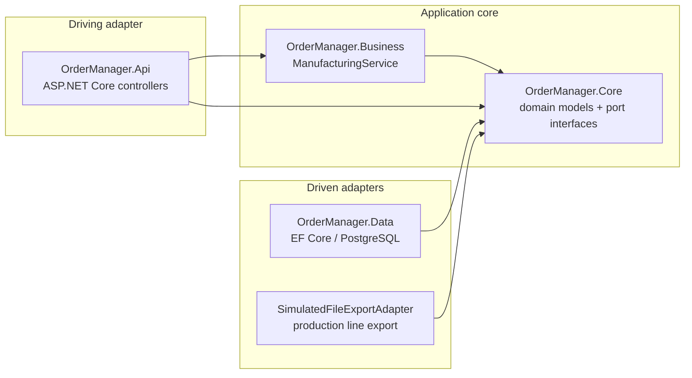

# OrderManager

A REST API for managing manufacturing orders, built as a coding-challenge submission.

## Domain

Three core entities:

- **Component** — a reusable SMT part with a stock quantity
- **Board** — a PCB design with physical dimensions (mm); references components via `BoardComponent` (many-to-many with `QuantityPerBoard`)
- **Order** — a production order placed on a date; references boards via `OrderBoard` (many-to-many with `Quantity`)

An order can be exported to the production line (`POST /api/orders/{id}/export`), which writes a JSON file to the local filesystem via a simulated adapter.

## Architecture

Hexagonal (Ports & Adapters) — see [docs/adr/ADR-001-architecture-style.md](docs/adr/ADR-001-architecture-style.md).



Dependency violations are compile errors enforced by `Directory.Build.props`.

## Tech Stack

- .NET 10 / C# (latest)
- ASP.NET Core with Scalar UI (`/scalar/v1`)
- EF Core 10 + Npgsql (PostgreSQL)
- MSTest 3 + NSubstitute + Testcontainers (for integration tests with real database)

## Getting Started

**Option A — Docker only** (prerequisites: Docker):

```powershell
docker compose up --build
```

**Option B — .NET SDK + Docker** (prerequisites: .NET 10 SDK, Docker):

```powershell
# Start only the database
docker compose up -d db

# Run the API locally
dotnet run --project src/OrderManager.Api
```

The API is available at `http://localhost:8080`.

```powershell
# Run all tests (unit + in-memory adapter)
dotnet test
```

## API Explorer

| URL | Description |
|-----|-------------|
| `http://localhost:8080/scalar/v1` | Scalar interactive API explorer |
| `http://localhost:8080/openapi/v1.json` | OpenAPI JSON spec |

## Tests

The `dotnet test` suite covers the service layer (unit tests with mocked ports) and the EF Core adapter (in-memory and one real-Postgres integration test via Testcontainers).

The `tests/` folder also contains Python scripts for manual validation — see [tests/README.md](tests/README.md).

## Architecture Decision Records

All significant design choices are documented in [docs/adr/](docs/adr/).

## Known Limitations

These are deliberate trade-offs for the scope of a coding challenge:

- **No HTTP-layer tests.** The controllers have no `WebApplicationFactory`-based integration tests. The Python e2e script in `tests/` fills this gap manually.
- **Database credentials in source.** The PostgreSQL password is hardcoded in `appsettings.Development.json` and `docker-compose.yml`. A production setup would use User Secrets or environment variables.
- **Export file retention.** `SimulatedFileExportAdapter` writes JSON files to the local filesystem but never deletes them. A production adapter would include a retention/cleanup policy.
- **Simplified domain model.** `Board` and `Component` are treated as master data (Stammdaten) shared across orders — a deliberate simplification. A full MES model would distinguish between *board types* (catalog) and *physical board instances* (each with a unique ID tied to a DMC barcode), where the same board type appearing twice in an order produces two distinct tracked instances.
- **No HTTPS in Development.** The `http` launch profile is used in development to avoid a redirect loop; HTTPS is available via the `https` profile.
- **No DbContext constraints.** `HasMaxLength`, explicit `OnDelete` behaviour, and FK indexes are not configured in `OrderManagerDbContext` — EF Core conventions and PostgreSQL defaults are relied upon instead.
