# Class Diagram — Full Solution

All four projects in one view. Arrows show dependency direction (hexagonal rule: everything points inward toward `Core`).

```mermaid
classDiagram
    namespace Core_Models {
        class Order {
            +Guid Id
            +string Name
            +string? Description
            +DateTime OrderDate
            +List~Board~ Boards
            +IReadOnlyList~IDomainEvent~ DomainEvents
            +Complete() void
            +ClearEvents() void
        }
        class Board {
            +Guid Id
            +string Name
            +string? Description
            +decimal Length
            +decimal Width
            +List~Component~ Components
        }
        class Component {
            +Guid Id
            +string Name
            +string? Description
            +int StockQuantity
        }
        class BoardComponent {
            +Guid BoardId
            +Guid ComponentId
            +int QuantityPerBoard
        }
    }

    namespace Core_Ports {
        class IOrderRepository {
            <<interface>>
            +GetByIdAsync(Guid id, CancellationToken ct) Task~Order?~
            +GetAllAsync(CancellationToken ct) Task~IEnumerable~Order~~
            +AddAsync(Order order, CancellationToken ct) Task
            +UpdateAsync(Order order, CancellationToken ct) Task
            +DeleteAsync(Guid id, CancellationToken ct) Task
        }
        class IBoardRepository {
            <<interface>>
            +GetByIdAsync(Guid id, CancellationToken ct) Task~Board?~
            +GetAllAsync(CancellationToken ct) Task~IEnumerable~Board~~
            +AddAsync(Board board, CancellationToken ct) Task
            +UpdateAsync(Board board, CancellationToken ct) Task
            +DeleteAsync(Guid id, CancellationToken ct) Task
        }
        class IComponentRepository {
            <<interface>>
            +GetByIdAsync(Guid id, CancellationToken ct) Task~Component?~
            +GetAllAsync(CancellationToken ct) Task~IEnumerable~Component~~
            +AddAsync(Component component, CancellationToken ct) Task
            +UpdateAsync(Component component, CancellationToken ct) Task
            +DeleteAsync(Guid id, CancellationToken ct) Task
        }
        class IOrderService {
            <<interface>>
            +CreateAsync(CreateOrderRequest req, CancellationToken ct) Task~Order~
            +GetByIdAsync(Guid id, CancellationToken ct) Task~Order?~
            +GetAllAsync(CancellationToken ct) Task~IEnumerable~Order~~
            +UpdateAsync(Guid id, UpdateOrderRequest req, CancellationToken ct) Task~Order?~
            +DeleteAsync(Guid id, CancellationToken ct) Task~bool~
            +ExportToProductionLineAsync(Guid id, CancellationToken ct) Task
        }
        class IBoardService {
            <<interface>>
            +CreateAsync(CreateBoardRequest req, CancellationToken ct) Task~Board~
            +GetByIdAsync(Guid id, CancellationToken ct) Task~Board?~
            +GetAllAsync(CancellationToken ct) Task~IEnumerable~Board~~
            +UpdateAsync(Guid id, UpdateBoardRequest req, CancellationToken ct) Task~Board?~
            +DeleteAsync(Guid id, CancellationToken ct) Task~bool~
        }
        class IComponentService {
            <<interface>>
            +CreateAsync(CreateComponentRequest req, CancellationToken ct) Task~Component~
            +GetByIdAsync(Guid id, CancellationToken ct) Task~Component?~
            +GetAllAsync(CancellationToken ct) Task~IEnumerable~Component~~
            +UpdateAsync(Guid id, UpdateComponentRequest req, CancellationToken ct) Task~Component?~
            +DeleteAsync(Guid id, CancellationToken ct) Task~bool~
        }
        class IProductionLineExporter {
            <<interface>>
            +ExportAsync(Order order, CancellationToken ct) Task
        }
    }

    namespace Business_Services {
        class OrderService {
            -IOrderRepository _repo
            -IProductionLineExporter _exporter
            -ILogger~OrderService~ _logger
            +CreateAsync(CreateOrderRequest req, CancellationToken ct) Task~Order~
            +GetByIdAsync(Guid id, CancellationToken ct) Task~Order?~
            +GetAllAsync(CancellationToken ct) Task~IEnumerable~Order~~
            +UpdateAsync(Guid id, UpdateOrderRequest req, CancellationToken ct) Task~Order?~
            +DeleteAsync(Guid id, CancellationToken ct) Task~bool~
            +ExportToProductionLineAsync(Guid id, CancellationToken ct) Task
        }
        class BoardService {
            -IBoardRepository _repo
            -ILogger~BoardService~ _logger
            +CreateAsync(CreateBoardRequest req, CancellationToken ct) Task~Board~
            +GetByIdAsync(Guid id, CancellationToken ct) Task~Board?~
            +GetAllAsync(CancellationToken ct) Task~IEnumerable~Board~~
            +UpdateAsync(Guid id, UpdateBoardRequest req, CancellationToken ct) Task~Board?~
            +DeleteAsync(Guid id, CancellationToken ct) Task~bool~
        }
        class ComponentService {
            -IComponentRepository _repo
            -ILogger~ComponentService~ _logger
            +CreateAsync(CreateComponentRequest req, CancellationToken ct) Task~Component~
            +GetByIdAsync(Guid id, CancellationToken ct) Task~Component?~
            +GetAllAsync(CancellationToken ct) Task~IEnumerable~Component~~
            +UpdateAsync(Guid id, UpdateComponentRequest req, CancellationToken ct) Task~Component?~
            +DeleteAsync(Guid id, CancellationToken ct) Task~bool~
        }
    }

    namespace Data_Adapters {
        class AppDbContext {
            +DbSet~Order~ Orders
            +DbSet~Board~ Boards
            +DbSet~Component~ Components
            +OnModelCreating(ModelBuilder mb) void
        }
        class OrderRepository {
            -AppDbContext _db
            +GetByIdAsync(Guid id, CancellationToken ct) Task~Order?~
            +GetAllAsync(CancellationToken ct) Task~IEnumerable~Order~~
            +AddAsync(Order order, CancellationToken ct) Task
            +UpdateAsync(Order order, CancellationToken ct) Task
            +DeleteAsync(Guid id, CancellationToken ct) Task
        }
        class BoardRepository {
            -AppDbContext _db
            +GetByIdAsync(Guid id, CancellationToken ct) Task~Board?~
            +GetAllAsync(CancellationToken ct) Task~IEnumerable~Board~~
            +AddAsync(Board board, CancellationToken ct) Task
            +UpdateAsync(Board board, CancellationToken ct) Task
            +DeleteAsync(Guid id, CancellationToken ct) Task
        }
        class ComponentRepository {
            -AppDbContext _db
            +GetByIdAsync(Guid id, CancellationToken ct) Task~Component?~
            +GetAllAsync(CancellationToken ct) Task~IEnumerable~Component~~
            +AddAsync(Component component, CancellationToken ct) Task
            +UpdateAsync(Component component, CancellationToken ct) Task
            +DeleteAsync(Guid id, CancellationToken ct) Task
        }
        class SimulatedFileExportAdapter {
            -string _exportPath
            -ILogger~SimulatedFileExportAdapter~ _logger
            +ExportAsync(Order order, CancellationToken ct) Task
        }
    }

    namespace Api_CompositionRoot {
        class Program {
            <<composition root>>
            +WebApplication Build(string[] args)$
        }
        class OrdersController {
            -IOrderService _service
            +GetAll(CancellationToken ct) Task~IActionResult~
            +GetById(Guid id, CancellationToken ct) Task~IActionResult~
            +Create(CreateOrderRequest req, CancellationToken ct) Task~IActionResult~
            +Update(Guid id, UpdateOrderRequest req, CancellationToken ct) Task~IActionResult~
            +Delete(Guid id, CancellationToken ct) Task~IActionResult~
            +Export(Guid id, CancellationToken ct) Task~IActionResult~
        }
        class BoardsController {
            -IBoardService _service
            +GetAll(CancellationToken ct) Task~IActionResult~
            +GetById(Guid id, CancellationToken ct) Task~IActionResult~
            +Create(CreateBoardRequest req, CancellationToken ct) Task~IActionResult~
            +Update(Guid id, UpdateBoardRequest req, CancellationToken ct) Task~IActionResult~
            +Delete(Guid id, CancellationToken ct) Task~IActionResult~
        }
        class ComponentsController {
            -IComponentService _service
            +GetAll(CancellationToken ct) Task~IActionResult~
            +GetById(Guid id, CancellationToken ct) Task~IActionResult~
            +Create(CreateComponentRequest req, CancellationToken ct) Task~IActionResult~
            +Update(Guid id, UpdateComponentRequest req, CancellationToken ct) Task~IActionResult~
            +Delete(Guid id, CancellationToken ct) Task~IActionResult~
        }
    }

    %% Domain relationships
    Order "1" --> "*" Board : has (via OrderBoard)
    Board "1" --> "*" Component : has (via BoardComponent)
    BoardComponent --> Board
    BoardComponent --> Component

    %% Implementations
    OrderService ..|> IOrderService
    BoardService ..|> IBoardService
    ComponentService ..|> IComponentService
    OrderRepository ..|> IOrderRepository
    BoardRepository ..|> IBoardRepository
    ComponentRepository ..|> IComponentRepository
    SimulatedFileExportAdapter ..|> IProductionLineExporter

    %% Business → Core ports (constructor injection)
    OrderService --> IOrderRepository : injects
    OrderService --> IProductionLineExporter : injects
    BoardService --> IBoardRepository : injects
    ComponentService --> IComponentRepository : injects

    %% Data → AppDbContext
    OrderRepository --> AppDbContext : injects
    BoardRepository --> AppDbContext : injects
    ComponentRepository --> AppDbContext : injects

    %% Api controllers → service ports
    OrdersController --> IOrderService : injects
    BoardsController --> IBoardService : injects
    ComponentsController --> IComponentService : injects

    %% Program.cs wires ports to adapters (composition root)
    Program ..> IOrderRepository : registers OrderRepository
    Program ..> IBoardRepository : registers BoardRepository
    Program ..> IComponentRepository : registers ComponentRepository
    Program ..> IOrderService : registers OrderService
    Program ..> IBoardService : registers BoardService
    Program ..> IComponentService : registers ComponentService
    Program ..> IProductionLineExporter : registers SimulatedFileExportAdapter
```

## Notes

- `OrderBoard` (Order ↔ Board junction) has no payload — EF Core maps it via `UsingEntity` without a dedicated class; shown as a navigational relationship only.
- `BoardComponent` has `QuantityPerBoard` payload so it gets its own class.
- `DomainEvents` / `Complete()` / `ClearEvents()` on `Order` are pre-wired for the optional domain-event pattern (see [ADR-004](../adr/ADR-004-domain-events.md)) — remove them if domain events are deferred.
- `SimulatedFileExportAdapter` is registered in DI for the `Development` environment only; a real factory-floor adapter (MQTT, IPC-CFX) replaces it in `Production` via a single DI registration change.
- `Program.cs` is the **Composition Root** — the only place that references both `OrderManager.Data` and `OrderManager.Business`. It wires every port to its adapter via DI. No domain or business class ever calls `new` on an infrastructure type.
- Repository mutating methods (`AddAsync`, `UpdateAsync`, `DeleteAsync`) commit immediately inside the implementation — `SaveChangesAsync` is an EF Core detail that must not leak into the `Core` port interface.
- Controllers inject only the `IXxxService` port — never a repository directly. They translate HTTP ↔ domain and delegate all logic to the service.
