# Class Diagram — Full Solution

All four projects in one view. Arrows show dependency direction (hexagonal rule: everything points inward toward `Core`).

```mermaid
classDiagram
    namespace Core_Models {
        class Order {
            +Guid Id
            +string Name
            +string? Description
            +DateTime OrderDate
            +IReadOnlyList~OrderBoard~ OrderBoards
            +AddBoard(OrderBoard) void
            +RemoveBoard(Guid boardId) void
        }
        class Board {
            +Guid Id
            +string Name
            +string? Description
            +decimal Length
            +decimal Width
            +IReadOnlyList~BoardComponent~ BoardComponents
            +AddComponent(BoardComponent) void
            +RemoveComponent(Guid componentId) void
        }
        class Component {
            +Guid Id
            +string Name
            +string? Description
            +int Quantity
        }
        class OrderBoard {
            +Guid OrderId
            +Guid BoardId
            +Board Board
            +int Quantity
        }
        class BoardComponent {
            +Guid BoardId
            +Guid ComponentId
            +Component Component
            +int QuantityPerBoard
        }
    }

    namespace Core_Ports {
        class IOrderDataPort {
            <<interface>>
            +GetOrderWithDetailsAsync(Guid id, CancellationToken ct) Task~Order?~
            +GetOrderByIdAsync(Guid id, CancellationToken ct) Task~Order?~
            +GetAllOrdersAsync(CancellationToken ct) Task~IReadOnlyList~Order~~
            +AddOrderAsync(Order order, CancellationToken ct) Task
            +UpdateOrderAsync(Order order, CancellationToken ct) Task
            +DeleteOrderAsync(Guid id, CancellationToken ct) Task
            +AddBoardToOrderAsync(Guid orderId, Guid boardId, int qty, CancellationToken ct) Task
            +RemoveBoardFromOrderAsync(Guid orderId, Guid boardId, CancellationToken ct) Task~bool~
        }
        class IBoardDataPort {
            <<interface>>
            +GetBoardWithDetailsAsync(Guid id, CancellationToken ct) Task~Board?~
            +GetBoardByIdAsync(Guid id, CancellationToken ct) Task~Board?~
            +GetAllBoardsAsync(CancellationToken ct) Task~IReadOnlyList~Board~~
            +AddBoardAsync(Board board, CancellationToken ct) Task
            +UpdateBoardAsync(Board board, CancellationToken ct) Task
            +DeleteBoardAsync(Guid id, CancellationToken ct) Task
            +AddComponentToBoardAsync(Guid boardId, Guid componentId, int qty, CancellationToken ct) Task
            +RemoveComponentFromBoardAsync(Guid boardId, Guid componentId, CancellationToken ct) Task~bool~
        }
        class IComponentDataPort {
            <<interface>>
            +GetComponentByIdAsync(Guid id, CancellationToken ct) Task~Component?~
            +GetAllComponentsAsync(CancellationToken ct) Task~IReadOnlyList~Component~~
            +AddComponentAsync(Component component, CancellationToken ct) Task
            +UpdateComponentAsync(Component component, CancellationToken ct) Task
            +DeleteComponentAsync(Guid id, CancellationToken ct) Task
        }
        class IManufacturingService {
            <<interface>>
            +CreateOrderAsync(CreateOrderRequest req, CancellationToken ct) Task~Order~
            +GetOrderByIdAsync(Guid id, CancellationToken ct) Task~Order?~
            +GetAllOrdersAsync(CancellationToken ct) Task~IEnumerable~Order~~
            +UpdateOrderAsync(Guid id, UpdateOrderRequest req, CancellationToken ct) Task~Order?~
            +DeleteOrderAsync(Guid id, CancellationToken ct) Task~bool~
            +ExportToProductionLineAsync(Guid id, CancellationToken ct) Task
            +AddBoardToOrderAsync(Guid orderId, Guid boardId, int qty, CancellationToken ct) Task~bool~
            +RemoveBoardFromOrderAsync(Guid orderId, Guid boardId, CancellationToken ct) Task~bool~
            +CreateBoardAsync(CreateBoardRequest req, CancellationToken ct) Task~Board~
            +GetBoardByIdAsync(Guid id, CancellationToken ct) Task~Board?~
            +GetAllBoardsAsync(CancellationToken ct) Task~IEnumerable~Board~~
            +UpdateBoardAsync(Guid id, UpdateBoardRequest req, CancellationToken ct) Task~Board?~
            +DeleteBoardAsync(Guid id, CancellationToken ct) Task~bool~
            +AddComponentToBoardAsync(Guid boardId, Guid componentId, int qty, CancellationToken ct) Task~bool~
            +RemoveComponentFromBoardAsync(Guid boardId, Guid componentId, CancellationToken ct) Task~bool~
            +CreateComponentAsync(CreateComponentRequest req, CancellationToken ct) Task~Component~
            +GetComponentByIdAsync(Guid id, CancellationToken ct) Task~Component?~
            +GetAllComponentsAsync(CancellationToken ct) Task~IEnumerable~Component~~
            +UpdateComponentAsync(Guid id, UpdateComponentRequest req, CancellationToken ct) Task~Component?~
            +DeleteComponentAsync(Guid id, CancellationToken ct) Task~bool~
        }
        class IProductionLineExporter {
            <<interface>>
            +ExportAsync(Order order, CancellationToken ct) Task
        }
    }

    namespace Business_Services {
        class ManufacturingService {
            <<sealed>>
            -IOrderDataPort _orderData
            -IBoardDataPort _boardData
            -IComponentDataPort _componentData
            -IProductionLineExporter _exporter
            -ILogger~ManufacturingService~ _logger
        }
    }

    namespace Data_Adapters {
        class OrderManagerDbContext {
            +DbSet~Order~ Orders
            +DbSet~Board~ Boards
            +DbSet~Component~ Components
            +OnModelCreating(ModelBuilder mb) void
        }
        class EfCoreDataAdapter {
            <<sealed>>
            -OrderManagerDbContext _context
            -ILogger~EfCoreDataAdapter~ _logger
        }
        class SimulatedFileExportAdapter {
            -string _exportPath
            -ILogger~SimulatedFileExportAdapter~ _logger
            +ExportAsync(Order order, CancellationToken ct) Task
        }
    }

    namespace Api_CompositionRoot {
        class Program {
            <<composition root>>
            +WebApplication Build(string[] args)$
        }
        class OrderResponse {
            +Guid Id
            +string Name
            +string Description
            +DateTimeOffset OrderDate
            +IReadOnlyList~BoardEntry~ Boards
            +From(Order o)$ OrderResponse
        }
        class BoardResponse {
            +Guid Id
            +string Name
            +string Description
            +decimal Length
            +decimal Width
            +IReadOnlyList~ComponentEntry~ Components
            +From(Board b)$ BoardResponse
        }
        class OrdersController {
            -IManufacturingService _service
            +GetAll(CancellationToken ct) Task~IActionResult~
            +GetById(Guid id, CancellationToken ct) Task~IActionResult~
            +Create(CreateOrderRequest req, CancellationToken ct) Task~IActionResult~
            +Update(Guid id, UpdateOrderRequest req, CancellationToken ct) Task~IActionResult~
            +Delete(Guid id, CancellationToken ct) Task~IActionResult~
            +AddBoard(Guid orderId, Guid boardId, CancellationToken ct) Task~IActionResult~
            +RemoveBoard(Guid orderId, Guid boardId, CancellationToken ct) Task~IActionResult~
            +Export(Guid id, CancellationToken ct) Task~IActionResult~
        }
        class BoardsController {
            -IManufacturingService _service
            +GetAll(CancellationToken ct) Task~IActionResult~
            +GetById(Guid id, CancellationToken ct) Task~IActionResult~
            +Create(CreateBoardRequest req, CancellationToken ct) Task~IActionResult~
            +Update(Guid id, UpdateBoardRequest req, CancellationToken ct) Task~IActionResult~
            +AddComponent(Guid boardId, Guid componentId, AddComponentToBoardRequest req, CancellationToken ct) Task~IActionResult~
            +RemoveComponent(Guid boardId, Guid componentId, CancellationToken ct) Task~IActionResult~
            +Delete(Guid id, CancellationToken ct) Task~IActionResult~
        }
        class ComponentsController {
            -IManufacturingService _service
            +GetAll(CancellationToken ct) Task~IActionResult~
            +GetById(Guid id, CancellationToken ct) Task~IActionResult~
            +Create(CreateComponentRequest req, CancellationToken ct) Task~IActionResult~
            +Update(Guid id, UpdateComponentRequest req, CancellationToken ct) Task~IActionResult~
            +Delete(Guid id, CancellationToken ct) Task~IActionResult~
        }
    }

    %% Domain relationships (one-directional per ADR-011)
    Order "1" --> "*" OrderBoard : owns
    OrderBoard --> Board : references
    Board "1" --> "*" BoardComponent : owns
    BoardComponent --> Component : references

    %% Implementations
    ManufacturingService ..|> IManufacturingService
    EfCoreDataAdapter ..|> IOrderDataPort
    EfCoreDataAdapter ..|> IBoardDataPort
    EfCoreDataAdapter ..|> IComponentDataPort
    SimulatedFileExportAdapter ..|> IProductionLineExporter

    %% Business → Core ports (constructor injection)
    ManufacturingService --> IOrderDataPort : injects
    ManufacturingService --> IBoardDataPort : injects
    ManufacturingService --> IComponentDataPort : injects
    ManufacturingService --> IProductionLineExporter : injects

    %% Data → OrderManagerDbContext
    EfCoreDataAdapter --> OrderManagerDbContext : injects

    %% Api controllers → service port
    OrdersController --> IManufacturingService : injects
    BoardsController --> IManufacturingService : injects
    ComponentsController --> IManufacturingService : injects

    %% Controllers map entities to DTOs
    OrdersController --> OrderResponse : maps to
    BoardsController --> BoardResponse : maps to

    %% Program.cs wires ports to adapters (composition root)
    Program ..> IOrderDataPort : registers EfCoreDataAdapter
    Program ..> IBoardDataPort : registers EfCoreDataAdapter
    Program ..> IComponentDataPort : registers EfCoreDataAdapter
    Program ..> IManufacturingService : registers ManufacturingService
    Program ..> IProductionLineExporter : registers SimulatedFileExportAdapter
```

## Notes

- Navigation is **one-directional** per [ADR-011](../adr/ADR-011-domain-ownership.md): `Order → Board` and `Board → Component`. `Board` and `Component` are Stammdaten and have no back-references to their owning aggregates.
- `OrderBoard` carries `Quantity` (boards per order); `BoardComponent` carries `QuantityPerBoard` (components per board).
- Controllers map domain entities to response DTOs (`OrderResponse`, `BoardResponse`) before serialisation — no direct entity serialisation.
- `ManufacturingService` owns all three data ports directly; no service-to-service injection is needed. See [ADR-010](../adr/ADR-010-unified-manufacturing-service.md) for the rationale.
- `IOrderDataPort`, `IBoardDataPort`, and `IComponentDataPort` remain split per [ADR-009](../adr/ADR-009-split-data-ports.md) — ISP still applies at the persistence layer.
- `SimulatedFileExportAdapter` is registered in DI for the `Development` environment only; a real factory-floor adapter (MQTT, IPC-CFX) replaces it in `Production` via a single DI registration change.
- `Program.cs` is the **Composition Root** — the only place that references both `OrderManager.Data` and `OrderManager.Business`.
