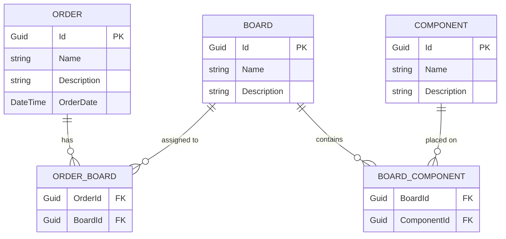

# Domain Model — Entity Relationship Diagram

Three core entities linked by two junction tables for the many-to-many relationships.

## Notes

- All primary keys are auto-generated `Guid` values.
- `ORDER_BOARD` and `BOARD_COMPONENT` are pure junction tables with no additional payload — EF Core's `UsingEntity` maps them without a dedicated entity class.
- One `Board` can appear in many `Orders`; one `Component` can appear on many `Boards`.
