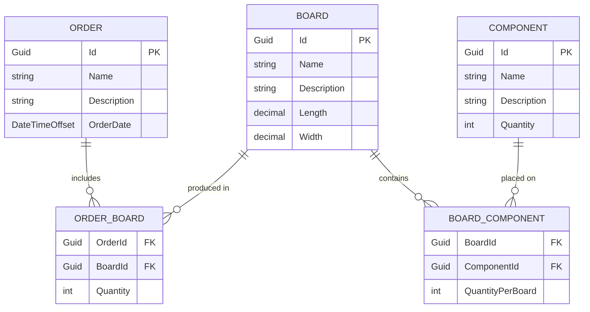

# Domain Model — Entity Relationship Diagram

Three core entities linked by two junction tables for the many-to-many relationships.

## Notes

- All primary keys are auto-generated `Guid` values.
- `ORDER_BOARD.Quantity` — how many of this board type are required for the order.
- `BOARD_COMPONENT.QuantityPerBoard` — how many of this component are required per board.
- **Domain navigation is one-directional** (see [ADR-011](../adr/ADR-011-domain-ownership.md)): `Order` owns `ORDER_BOARD` entries, `Board` owns `BOARD_COMPONENT` entries. The ERD shows the full relational schema; at the C# domain level, `Board` and `Component` are Stammdaten and do not hold collections back to their referencing aggregates.
- Cascade delete applies only to junction rows: deleting an `Order` removes its `ORDER_BOARD` rows but never deletes `BOARD` or `COMPONENT` records.
