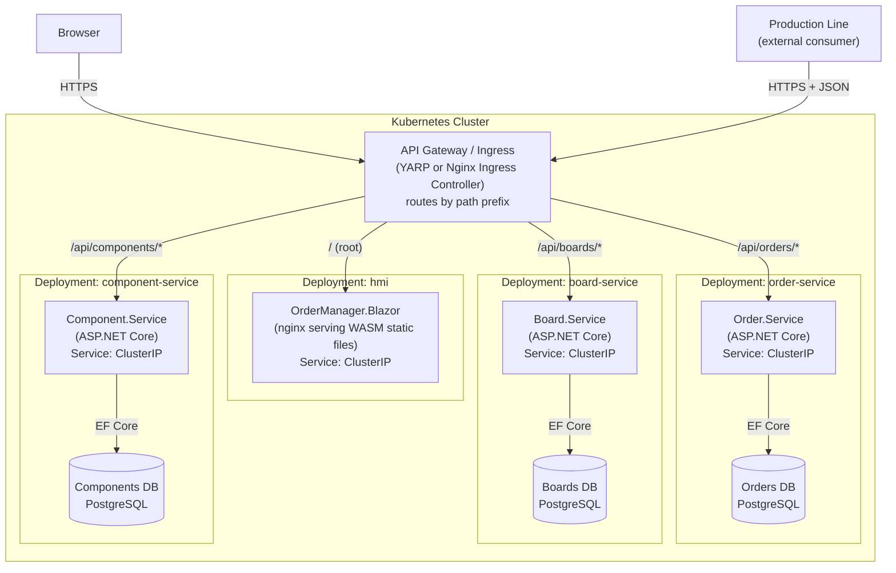

# Future State — Microservices on Kubernetes

This diagram shows how **Option B** (REST API + Blazor WASM, Hexagonal) evolves into a full microservices deployment on Kubernetes. No business logic is rewritten — the hexagonal adapters are extracted into separate services and each gets its own database.

## Evolution path

| Step | Action | Business logic changes |
|---|---|---|
| 1 — Today | Single API + Blazor WASM in Docker Compose + SQLite | None — this is the starting point |
| 2 — Near future | Swap SQLite for PostgreSQL (connection string + EF migration) | Zero — only `OrderManager.Data` changes |
| 3 — Microservices | Split `OrderManager.Api` along domain boundaries | Zero — handlers/services move into new projects, interfaces stay the same |
| 4 — Kubernetes | Add Deployments, Services, Ingress YAML; API Gateway for routing | Zero — infrastructure only |

## Target microservices architecture



## Why this works without rewriting business logic

In Option B, `OrderManager.Business` contains pure C# classes that depend only on `OrderManager.Core` interfaces. When splitting into microservices:

1. `Order.Service` copies `OrderManager.Business/Orders/*` and `OrderManager.Data/Repositories/OrderRepository.cs` — both are already isolated assemblies.
2. The service-specific `Program.cs` registers the same DI bindings.
3. Each service gets its own `AppDbContext` and PostgreSQL schema.
4. The `IOrderRepository` interface in `Core` stays unchanged — only its registration destination changes.

The hexagonal pattern means **the domain knows nothing about where it is deployed**. Moving it from a monolith to a Kubernetes pod requires no modification to business logic.

## Docker Compose (intermediate step, used during the challenge)

```yaml
services:
  api:
    build: ./src/OrderManager.Api
    ports:
      - "5000:8080"
    volumes:
      - sqlite-data:/data
    environment:
      - ConnectionStrings__Default=Data Source=/data/order-manager.db

  blazor:
    build: ./src/OrderManager.Blazor
    ports:
      - "5001:80"

volumes:
  sqlite-data:
```
