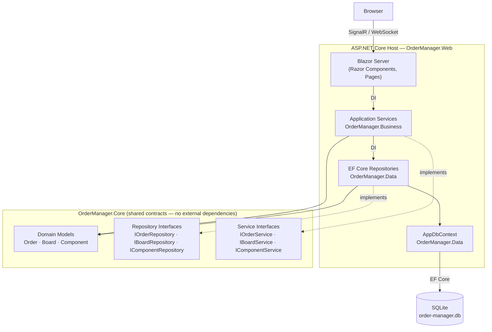

# Option A — Blazor Server Monolith (Layered)

A single ASP.NET Core process hosts both the Blazor Server UI and all business logic. UI events travel over a persistent SignalR WebSocket; no HTTP boundary exists between the UI and the domain.



## Project references

```
OrderManager.Web      → Business, Data, Core
OrderManager.Business → Core
OrderManager.Data     → Core
OrderManager.Core     → (none)
```

## Key trade-off

No REST API means JSON export to the production line must be a file-download action on a Blazor page (`NavigationManager.NavigateTo("/api/orders/{id}/export")`), rather than a first-class REST endpoint. Workable, but less clean and not reusable by external consumers.
