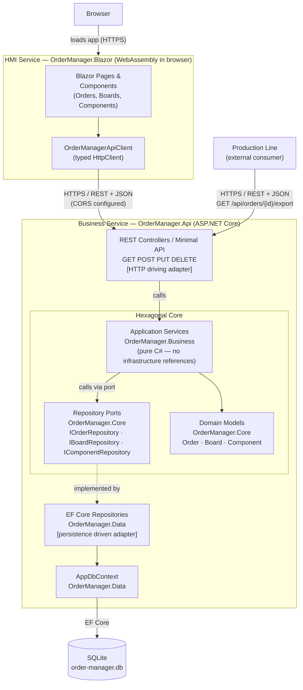

# Option B — REST API + Blazor WASM (Hexagonal / Ports & Adapters)

**This is the recommended option.** See [../architecture-concept.md](../architecture-concept.md) for the full rationale.

Two separate deployable units:
- `OrderManager.Api` — ASP.NET Core REST API, structured with hexagonal (Ports & Adapters) architecture
- `OrderManager.Blazor` — Blazor WebAssembly HMI, runs entirely in the browser after first load

The hexagonal core (`Core` + `Business`) defines interfaces ("ports"). HTTP controllers and EF Core repositories are "adapters" that plug in from outside. The domain never references any infrastructure package.



## Project references

```
OrderManager.Blazor   → (HttpClient only — no project references to server-side assemblies)
OrderManager.Api      → Business, Data, Core
OrderManager.Business → Core
OrderManager.Data     → Core
OrderManager.Core     → (none)
```

The dependency rule is enforced at compile time: if any developer adds `OrderManager.Data` as a reference to `OrderManager.Business`, the build fails.

## Docker Compose topology

```
┌─────────────────────────────────┐
│  docker-compose.yml             │
│                                 │
│  blazor   (nginx:alpine)        │  ← serves WASM static files
│  api      (mcr.microsoft.com/   │  ← ASP.NET Core API
│             dotnet/aspnet:8.0)  │
│  (SQLite file via bind mount)   │
└─────────────────────────────────┘
```

## JSON export endpoint

`GET /api/orders/{id}/export` returns the order serialised to JSON using `System.Text.Json`. The production line calls this endpoint directly. The Blazor UI can offer a download button that navigates to the same URL.
