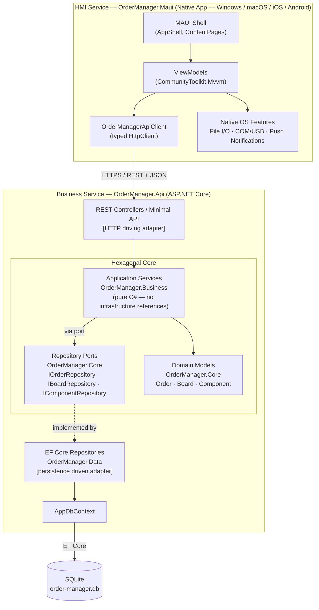

# Option C — REST API + MAUI Client (Hexagonal)

Same `OrderManager.Api` backend as Option B. The HMI is a .NET MAUI native application — a desktop/mobile shell that calls the API over HTTP and can additionally access native OS features (file system, COM/USB ports, OS notifications).



## Project references

```
OrderManager.Maui     → (HttpClient only — no project references to server-side assemblies)
OrderManager.Api      → Business, Data, Core
OrderManager.Business → Core
OrderManager.Data     → Core
OrderManager.Core     → (none)
```

## When to prefer this over Option B

- The HMI must run on factory-floor terminals without a browser
- The HMI needs direct access to local hardware (e.g. reading from SMT machine via COM port)
- Offline operation is required (MAUI can embed its own SQLite and sync later)

## Build complexity note

MAUI targets Android, iOS, macOS, and Windows from a single codebase. For a coding challenge targeting Windows only, set `<TargetFrameworks>net8.0-windows10.0.19041.0</TargetFrameworks>` in the `.csproj` to avoid requiring Android/iOS SDKs and a Mac agent.
