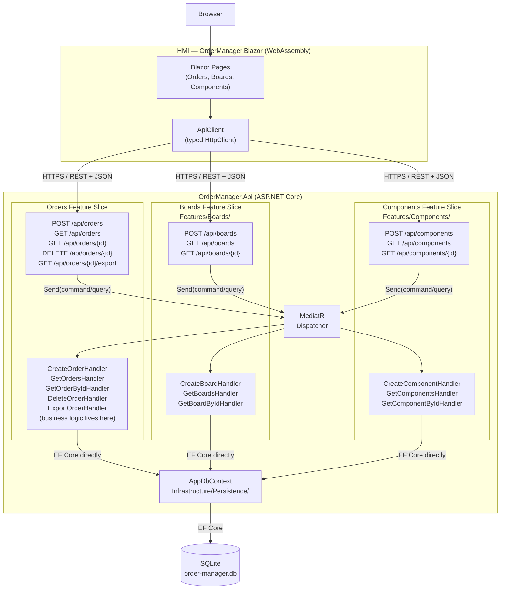

# Option D — Vertical Slice Architecture + Blazor WASM

Instead of horizontal layers (Core / Business / Data / Api), the API is organised around **features** — vertical slices. Each feature folder is self-contained: the command/query class, the handler (business logic lives here), a validator, and the Minimal API endpoint registration. MediatR dispatches requests to handlers. EF Core `DbContext` is used directly inside handlers — no generic repository abstraction.



## Folder structure

```
src/OrderManager.Api/
  Features/
    Orders/
      CreateOrder/
        CreateOrderCommand.cs
        CreateOrderHandler.cs
        CreateOrderValidator.cs
      GetOrders/
        GetOrdersQuery.cs
        GetOrdersHandler.cs
      ExportOrder/
        ExportOrderQuery.cs
        ExportOrderHandler.cs
      OrdersModule.cs        ← registers all /api/orders/* endpoints
    Boards/
      CreateBoard/ …
      BoardsModule.cs
    Components/
      CreateComponent/ …
      ComponentsModule.cs
  Infrastructure/
    Persistence/
      AppDbContext.cs
      Migrations/
  Program.cs
src/OrderManager.Blazor/     ← same as Option B
```

## Key trade-off vs Option B

Option D skips the generic Repository layer — each handler uses `AppDbContext` directly. This removes boilerplate but means the challenge's explicit Repository pattern requirement is not demonstrated. Option B is better if the rubric awards points for Repository + interface separation.
