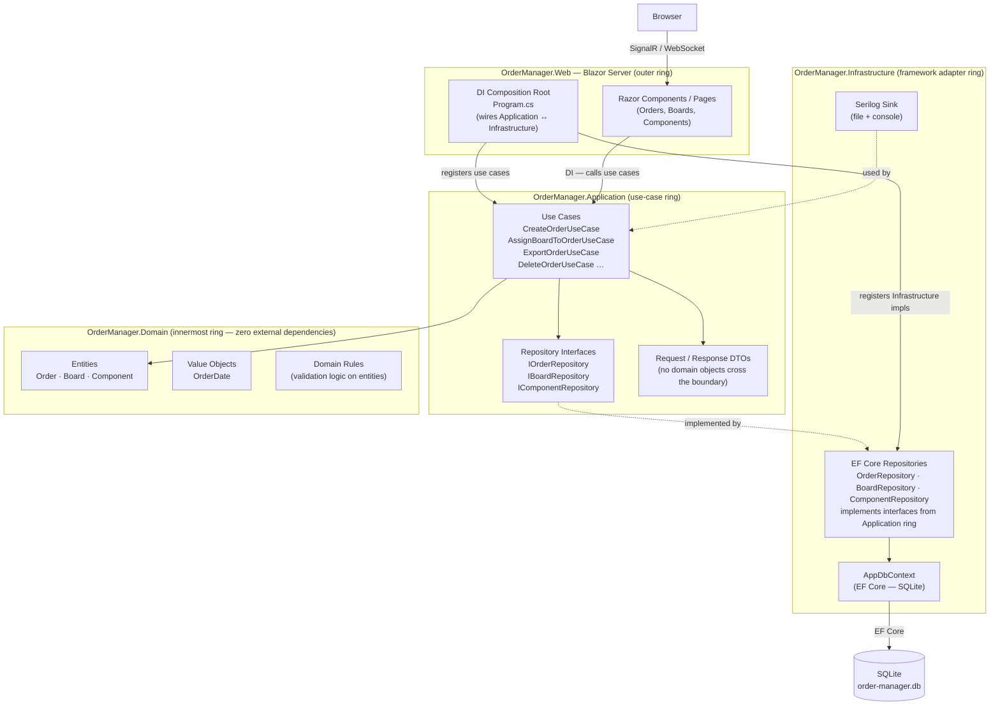

# Option E — Clean Architecture + Blazor Server

Robert C. Martin's Clean Architecture applied as concentric rings. Inner rings have no dependency on outer rings — enforced at the `.csproj` reference level. Blazor Server is the outer ring: a single deployable, no REST API needed.



## Project references (the dependency rule)

```
OrderManager.Web            → Application, Infrastructure (only for DI registration)
OrderManager.Infrastructure → Application, Domain
OrderManager.Application    → Domain
OrderManager.Domain         → (none)
```

`OrderManager.Web` references `Infrastructure` only in `Program.cs` for DI registration. All other `Web` code calls only `Application` interfaces — it never touches `Infrastructure` types directly.

## Key trade-off

The strictest dependency inversion of all options, but also the most boilerplate for a 3-entity CRUD app. Like Option A, it has no REST API, which means the JSON export to the production line requires a workaround rather than a clean endpoint. Also the same Blazor Server SignalR concern applies: horizontal scaling requires sticky sessions.
